# standup-board

A Jira-style board of every Claude Code session on your machine, in a pane
of the Claude desktop app's Code tab (it also works in the terminal). Use it
when the session sidebar gets hard to scan: one look shows what is running,
what is waiting on you, and what you are reviewing.

## Preview

In the desktop app each card has a little buddy that shows what the session is
doing, with a glow in its column's colour, and ring gauges count the columns:



A narrow pane stacks the columns. The terminal draws no pictures, so a glyph
stands in for the buddy:

<details>
<summary>Terminal, 40 columns</summary>

```text
5 active · 2 waiting for you

[ All 2 ] [ api 2 ] [ web ]   Show 1 idle project

● Running (2)
╭──────────────────────────────────────╮
│ ✻ Redesign the settings page         │
│   web                                │
│   running · just now                 │
│                                      │
│ ⧉ Copy  → Review                     │
╰──────────────────────────────────────╯

╭──────────────────────────────────────╮
│ ✻ Fix OAuth token refresh            │
│   api                                │
│   running · 1m ago                   │
│                                      │
│ ⧉ Copy  → Review                     │
╰──────────────────────────────────────╯

● Waiting for you (2)
╭──────────────────────────────────────╮
│ ⚿ Add rate limiting to /v2/search    │
│   api                                │
│   needs permission · 4m ago          │
│                                      │
│ ↗ Open  ⧉ Copy  → Review             │
╰──────────────────────────────────────╯

╭──────────────────────────────────────╮
│ ! Write migration for the invoices … │
│   api                                │
│   needs your reply · 22m ago         │
│                                      │
│ ⧉ Copy  → Review                     │
╰──────────────────────────────────────╯

● In review (1)
╭──────────────────────────────────────╮
│ ◎ Upgrade to React 19                │
│   web                                │
│   needs your reply · 2h ago          │
│                                      │
│ ⧉ Copy  ↩ Out of review              │
╰──────────────────────────────────────╯

● Done (3)
╭──────────────────────────────────────╮
│ z Investigate the memory leak        │
│   web                                │
│   gone quiet · 20m ago               │
│                                      │
│ ⧉ Copy  → Review                     │
╰──────────────────────────────────────╯

╭──────────────────────────────────────╮
│ z Fix the flaky checkout e2e test    │
│   web                                │
│   ended · 3h ago                     │
│                                      │
│ ⧉ Copy  → Review                     │
╰──────────────────────────────────────╯

╭──────────────────────────────────────╮
│ z Rotate the staging certificates    │
│   infra                              │
│   ended · 5h ago                     │
│                                      │
│ ⧉ Copy  → Review                     │
╰──────────────────────────────────────╯
```

</details>

Both previews show the sessions in `tests/fixtures.ts`, not real ones.

**It only sees sessions on the machine it runs on.** Each session reports
itself through a small file in `~/.claude/standup/`. Cloud sessions and
sessions on other computers never write there, so they don't show up.

## What it shows

| Column | How a card gets there |
| --- | --- |
| **Running** | Automatic: a turn is in progress. |
| **Waiting for you** | Automatic: the turn finished and needs your reply, or the session is on a permission prompt, a question, or an input form. A new session waits here until its first prompt. |
| **In review** | Manual: press **→ Review** on a card. **↩ Out of review** sends it back to its automatic column. |
| **Done** | Automatic: the session ended, or it has written nothing for 5 minutes (a crash or a force-quit). Done cards drop off the board after 24 hours. |

Each card shows the session title, its project, its status (for example
"needs permission" or "needs your reply") and the time since its last activity.

| Buddy (desktop) | Glyph (terminal) | Means |
| --- | --- | --- |
| Typing on a laptop, with a moving bar | `✻` | Running |
| Waving with a `!` bubble; the bar fills over the first hour | `!` | Waiting for your reply |
| `?`, lock, pencil, `…` or red `!` bubble | `?` `⚿` `✎` `…` `✕` | A question, a permission prompt, an input form, interrupted, or stopped on an error |
| Holding a magnifier | `◎` | In review |
| Asleep | `z` | Done |

The buddy is this plugin's own character, not Anthropic's logo or mascot.

**Projects.** Mods can't read the desktop app's environment names, so
sessions are grouped by **git repository**. A worktree session groups with its
main checkout. A folder that isn't a git repository groups by itself. Each
group is labelled with its folder name, plus the parent folder when two names
clash.

- The buttons at the top switch between **All** and one board per project. The
  current one is orange, and the amber badge in a button is how many sessions
  there are waiting for you.
- Projects that need you most come first; the tabs wrap onto more lines when
  there are many.
- Projects with no active session are hidden; **Show N idle projects**, at the
  right end of the tabs, shows them.
- The board remembers the project you viewed last.
- In a narrow pane the tabs wrap onto more lines and the columns stack.

**Opening a session.** Press a card to open that session in the Claude desktop
app (in the terminal, press its **↗ Open**). The board asks the operating system to open the
desktop app's own link, `claude://code/continue?session=local_…`.

A session started in a terminal has no desktop session, so pressing it copies
`cd <folder> && claude --resume <id>` instead. **⧉ Copy** copies that
command for any card. On the desktop the copy goes through macOS `pbcopy`,
because the desktop app doesn't give mods a clipboard yet.

## Install

Requires Claude Code 2.1.288 or later (the desktop app bundles its own copy).

From a shell:

```bash
claude plugin marketplace add Code-Growers/standup-board
```

```bash
claude plugin install standup-board@standup-board
```

At the prompt of a terminal session, the same two steps are
`/plugin marketplace add Code-Growers/standup-board` and
`/plugin install standup-board@standup-board`.

In the desktop app, where `/plugin` doesn't run: click **+** next to the
prompt box, then **Plugins**, **Add marketplace** with
`Code-Growers/standup-board`, then **Add plugin**.

Install it at the **user** scope so that it loads in every session. A session
shows on the board once the mod is loaded in it, so sessions that were already
open appear after their next restart (or `/reload-plugins`).

## Use

Type `/standup` to open the board. It refreshes every 2 seconds while open.

## How it works

- Every session runs the tracker. It writes only its own record:
  `~/.claude/standup/sessions/<session-id>.json`. One file per session means
  sessions never race on a shared file.
- The record holds the session id, title, group key, folder, status, the reason
  it waits, last activity, and a heartbeat that is rewritten every minute.
- The status comes from the session's events:

  | Event | Status |
  | --- | --- |
  | turn starts | running |
  | turn ends | waiting for your reply |
  | permission prompt, question tool, input request | waiting on you |
  | session ends | ended |

  Subagent turns don't change the status.
- The **In review** flag is the only thing the board writes. It goes in
  `~/.claude/standup/overrides/<session-id>.json`, and the session never
  writes there.
- The board reads both folders and rereads only the files that changed. If it
  catches a file mid-write, it keeps the last good copy.
- Your view (last project, the idle-projects toggle) is kept in the mod's own
  store.

## What it reads, writes, runs and sends

**Writes.** Only two kinds of small JSON files, both under `~/.claude/standup/`:

- `sessions/<session-id>.json`: each session's own record (title, folder, git
  repository root, status, timestamps). Written by that session.
- `overrides/<session-id>.json`: the **In review** flag, written by the board
  when you press a review button.

The file name comes from the session id, so the path can't be fixed text. These
are not build, settings, start-up or instruction files: no other tool reads,
runs or obeys them.

**Reads.**

- The two folders above.
- The session's id, folder and git repository root.
- The first prompt of the conversation, used as the card title when the
  session has no title of its own.
- The environment variables `HOME` and `USERPROFILE` (to find `~/.claude`) and
  `CLAUDE_CODE_HOST_SESSION_ID` (the desktop app's id for the session).

**Runs.** Only when you press something on a card:

- **Open** runs `open` (macOS), `xdg-open` (Linux) or `cmd /c start`
  (Windows) with the desktop app's link
  `claude://code/continue?session=local_…`, so the app shows that session.
  The id comes from the session's own record and must match the app's
  `local_…` pattern.
- **Copy** runs `pbcopy` (macOS) with the session's resume command
  (`cd <folder> && claude --resume <id>`) on its standard input, to put it on
  your clipboard. Where the surface has its own clipboard (the terminal),
  `pbcopy` isn't run.

**Sends.** Nothing leaves your machine. The plugin makes no network requests
and no model calls. The resume command goes only to your clipboard, and the
open link only to the desktop app on this machine.

**Hooks.** Every hook only observes and passes the event on unchanged. None of
them blocks, rewrites or answers anything, and none of them decides a
permission.

| Hook | What it does |
| --- | --- |
| `session.start` | Writes the session's first record and registers `/standup`. |
| `classic.SessionStart`, `classic.UserPromptSubmit` | Read the session title and the first prompt for the card title. |
| `turn.start`, `turn.complete` | Mark the session running, then waiting for your reply. |
| `classic.PermissionRequest` | Marks the session as waiting on a permission prompt. It doesn't answer the prompt: you still decide. |
| `classic.Elicitation`, `classic.ElicitationResult`, `classic.PermissionDenied` | Mark the session waiting on an input form, and back to running once answered. |
| `tool.call` | Marks the session waiting while Claude asks you a question, and stamps the time of the last activity. |
| `session.end` | Marks the session ended. |
| `command.run` (`/standup` only) | Opens the board. |
| `ui.close`, `ui.render` (the board's own pane only) | Stop the board's refresh timer, and draw the board. |

**Organization-managed installs.** Where an organization manages Claude Code,
`classic.*` events don't reach plugins you install yourself. The board still
works there, but cards take their title from the first prompt, and a session
on a permission prompt shows as running.

## Develop

```bash
claude plugin validate --strict .
```

```bash
claude plugin test .
```

The tests run against fixture sessions (`tests/fixtures.ts`) and need Claude
Code 2.1.299 or later, which draws styled text inside buttons. The plugin itself
runs on 2.1.288 too, with plain labels. They cover:

- the column and grouping rules
- the tracker's status changes
- the pane on the desktop and terminal surfaces, at a wide width and at a
  narrow 40-column width

To try local changes, start a session with
`claude --plugin-dir /path/to/standup-board`. Edits reload when you save.

To type-check, copy this build's declarations into
`.claude-plugin/types/` (the engine writes them there when it loads the mod
from a `--plugin-dir` folder), then run `tsc -p .`.

## License

[MIT](LICENSE) © Code Growers
